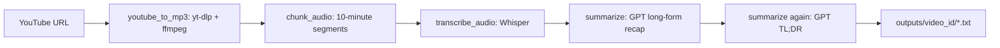

# Contributing

How to run the summarizer locally, where things live, and its one CI check.
What it does for a user is in [features.md](features.md).

## Run it locally

There is no `requirements.txt` or `pyproject.toml` in the repo, and no
dependency list anywhere in it today: a README Installation section once
gave a `pip install` line (from `09f4080`, 2024-05-20, until it was deleted
in `a7f8a1d`, 44 days later), but nothing has replaced it since. The
packages `transcript.py` actually imports are `librosa`, `openai`,
`python-dotenv` (as `dotenv`), `soundfile` and `yt-dlp` (as `yt_dlp`):

```sh
pip install librosa openai python-dotenv soundfile yt-dlp
```

You also need `ffmpeg` on your `PATH` (yt-dlp's audio extraction shells out
to it), and a `.env` file, `.gitignore`d, holding `OPENAI_KEY` — the actual
variable name `transcript.py` reads with `os.getenv('OPENAI_KEY')`. The
README's own example names `OPENAI_API_KEY` instead, which this script does
not read; see Known issues below.

`transcript.py` is written against the pre-1.0 OpenAI Python SDK:
`openai.Audio.transcribe(...)` and `openai.ChatCompletion.create(...)`.
Both calls were removed from the `openai` package starting with its 1.0
release. `pip install openai` today installs a version this script cannot
run against unmodified. Pin an `openai<1.0` release, or update the calls to
the current `client.audio.transcriptions.create` /
`client.chat.completions.create` style, to actually run it.

The script has no CLI argument parsing: open `transcript.py`, edit the
`youtube_url` and `outputs_dir` variables near the bottom of the file, and
run it directly:

```sh
python transcript.py
```

## Architecture

| Path            | What it is                                                                                |
| ---------------- | ------------------------------------------------------------------------------------------ |
| `transcript.py`  | the entire pipeline: download, chunk, transcribe, summarize — see [features.md](features.md) |
| `.github/workflows/vibecheck.yml` | a manually-triggered static-analysis workflow (`WolffM/vibecheck`) |

There is no package layout, no tests, and no entry point beyond running the
one file. Everything in `transcript.py` runs as one straight-line pipeline:



## Tests and gates

There are no tests and no linter configured to run automatically. The only
CI is `vibecheck.yml`, a `workflow_dispatch`-triggered job that runs a
static-analysis bot (`WolffM/vibecheck@main`) and can open its own
autofix pull requests; it does not run on pushes or pull requests by
itself. Five Copilot-authored pull requests (B007, F811, F401, a stray
semicolon, redundant YAML quoting) were merged the same day the workflow
was added; a sixth (suppressed mypy import errors) followed a month
later.

## Known issues

- The README's `.env` example names `OPENAI_API_KEY`; `transcript.py`
  actually reads `OPENAI_KEY`. Following the README literally leaves the
  script unable to find your key.
- Re-running the script for a video whose `summary.txt` already exists
  raises a `NameError` instead of reusing it — see
  [features.md](features.md#resumable-runs).
- `transcript.py` is written against the pre-1.0 OpenAI Python SDK; see
  "Run it locally" above.

## How it deploys

It doesn't: this is a script you run on your own machine against your own
OpenAI key, not a deployed service. A push to the default branch triggers
no build or release.

## Trivia

The repo has never had a requirements file. A README Installation section
once gave one, in prose, for 44 days in 2024; nothing has listed the
script's dependencies since (see "Run it locally" above).
